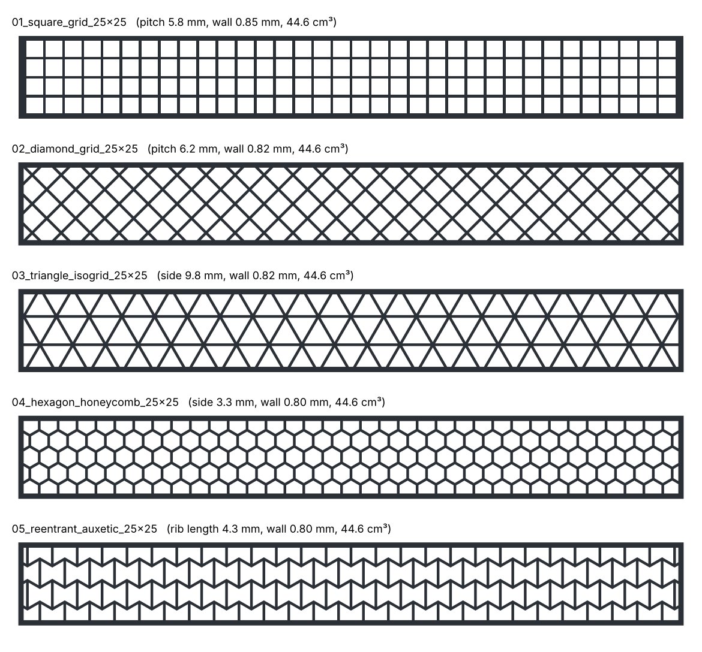

# Lattice beam bend test

Does the stiffness advantage of one lattice shape over another depend on the material it is printed in?

Cellular-solid theory (Gibson and Ashby) says it should not: the stiffness of a lattice divided by the stiffness of its solid material depends only on geometry and relative density. This project tests that with 3D-printed sandwich beams in three filaments.

**Status:** CAD and test plan done. Printing and testing not started. No results yet.



## Experiment

| | |
|---|---|
| Shapes tested | Triangle isogrid (stretch-dominated), hexagon honeycomb (bending-dominated) |
| Materials | PLA, PLA-CF, PAHT-CF |
| Copies | 3 per shape per material, 18 beams |
| Base-material test | 3 solid flex bars per material, 9 bars |
| Test | Three-point bend, 180 mm span for beams, 50 mm span for bars |

Every beam is 200 x 25 x 25 mm with 1.6 mm face sheets, roughly 0.8 mm cell walls and a core that is 25% solid. All shapes have the same solid volume, 44.56 cm³, so cell geometry is the only variable within one material.

## Hypothesis

1. For each beam, divide its measured stiffness by the flexural modulus of its own material (from the solid bars).
2. If the theory holds, that normalized stiffness is the same in all three materials for a given shape, so the triangle-to-hexagon ratio is constant.
3. If it changes, the cause is in the material: fiber alignment along the printed walls, layer adhesion, or moisture in the nylon.

Strength is expected to behave differently from stiffness, because it depends on how the cell walls fail (brittle fracture or buckling), and that does depend on the material.

Hand calculations are in [docs/predictions.md](docs/predictions.md). The test procedure is in [docs/test_protocol.md](docs/test_protocol.md).

## Repository layout

```
cad/       STEP and 3MF for the beams and the solid flex bar, plus the cross-section preview
scripts/   infill_beams.py, the parametric generator for everything in cad/
data/      blank result sheets, one row per specimen
docs/      predictions and test protocol
```

`cad/` holds five beam geometries (square, diamond, triangle, hexagon, re-entrant). Only triangle and hexagon are in the current test plan.

## Regenerating the CAD

```
pip install -r requirements.txt
python3 scripts/infill_beams.py
```

Beam size, skin, wall thickness and core density are constants at the top of the script. The script places each pattern so that no cell wall lies against a face sheet, then trims wall thickness by a few percent to match the target volume exactly.

## Printing

- Print with the 200 x 25 patterned face on the bed. Cells are vertical prisms, so no supports.
- 0.4 mm nozzle. Set wall loops high enough that cell walls and skins are all perimeters.
- Same settings for every beam within a material. Dry PAHT-CF the same way before every print and before testing.
- Weigh every specimen after printing and record it in `data/`.
