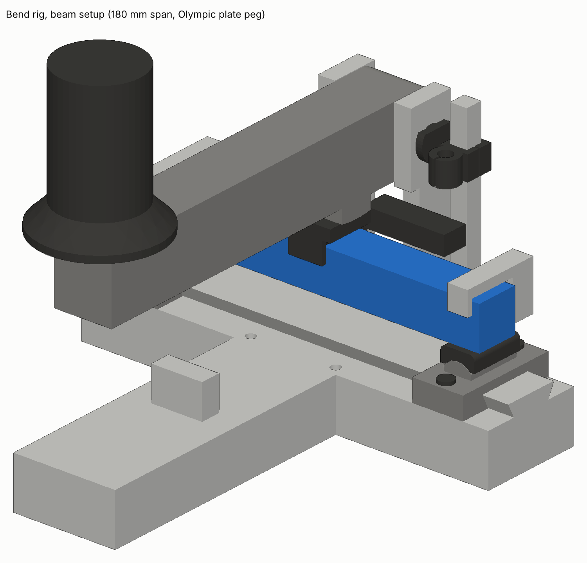
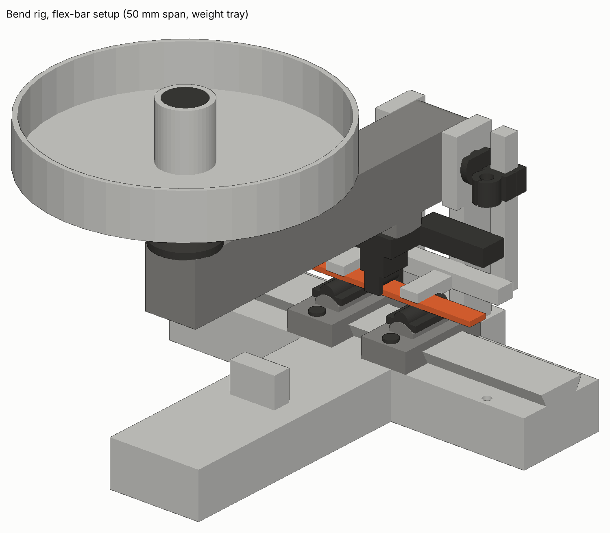

# Printed bend rig

A three-point bend rig made entirely of printed parts. It tests the 200 x 25 x 25 mm lattice beams at a 180 mm span and the solid flex bars at a 50 mm span. The only things you supply are the weights and a dial indicator.





## How it works

- **Lever:** the weights sit on a peg at the end of a 5:1 lever. Load on the specimen = 5 x the weight on the peg, plus the preload from the rig's own parts (below).
- **Design load:** 2 kN at the nose, which covers the strongest beams (PAHT-CF, estimated at about 1.9 kN). That takes about 38 kg on the peg. PLA beams should need about 21 kg.
- **Rocking supports:** the support pads rock on the saddles. They follow the beam's slope and don't dig in at an edge.
- **Load pad:** the nose presses through a 25 x 20 mm pad, which spreads the load over the face sheet.
- **Deflection:** the dial indicator rides on a yoke that rests on the specimen directly over the supports. It measures the specimen bending relative to its own support points, so flex and squash in the printed rig never enter the data.
- **Safety stop:** after about 14 mm of nose travel (a break), the lever lands on a stop built into the base instead of dropping the plates.

## Parts

| # | Part | Qty | Print notes |
|---|---|---|---|
| 01 | Base (rail, crosspiece, pivot tower, lever stop) | 1 | 240 x 247 mm, fills a P1S bed. As oriented. |
| 02 | Support saddle | 2 | As oriented, dovetail slot on the bed |
| 03 | Beam support pad | 2 | Flat top on the bed |
| 04 | Bar support pad (R5) | 2 | Flat face on the bed |
| 05 | Beam loading nose | 1 | Top face on the bed |
| 06 | Bar loading nose (R5) | 1 | Top face on the bed |
| 07 | Lever | 1 | On its side, so the layers run along its length |
| 08 | Pivot pin, 14 mm | 1 | On its flat |
| 09 | Pin keeper | 1 | As oriented |
| 10 | Saddle lock pin | 4 | Head down |
| 11 | Plate peg, 1-inch plates | 1 | Sleeve down |
| 12 | Plate peg, Olympic 2-inch plates | 1 | Sleeve down |
| 13 | Weight tray (flex bars) | 1 | As oriented |
| 14 | Beam deflection yoke | 1 | Needs supports |
| 15 | Bar deflection yoke | 1 | Needs supports |
| 16 | Indicator clamp, 8 mm stem | 1 | Print the one that fits your indicator |
| 17 | Indicator clamp, 3/8 in stem | 1 | |

Each part has a `.step` and a `.3mf` in this folder, already in print orientation. `assembly_beam.step` and `assembly_bar.step` show everything in place.

**Materials:**
- **PAHT-CF:** use it for the parts that carry the full load: lever, pivot pin, both noses, support pads and saddles.
- **PLA-CF or PLA:** fine for the base, yokes, pegs, tray and clamps.

Print the load-carrying parts with 5+ walls and 40%+ infill. Peak stress in the lever is about 10 MPa at 2 kN, and in the base about 9 MPa.

## Assembly

1. Slide both saddles onto the rail's dovetail. Line up each saddle's center notch with the span marks on the rail (180 mm for beams, 50 mm for bars), then drop two lock pins through each saddle into the rail.
2. Set a support pad on each saddle's rocker: flat pads for beams, R5 pads for bars.
3. Put the lever between the tower cheeks, push the pivot pin through, and press the keeper onto the end.
4. Push a peg down through the hole at the lever's free end.

## Running a test

1. Mark mid-span on the specimen and center it on the pads.
2. Set the nose on the specimen at mid-span, with its tab pointing toward the indicator post.
3. Set the yoke on the specimen with its feet directly over the support pads.
4. Slide the clamp onto the yoke post, push the indicator stem in, and lower it until the plunger rests on the nose tab with a few mm of travel used. Turn the dial face toward the end of the rig (−x) so it clears the tower.
5. Lower the lever onto the nose, then zero the indicator. That reading includes the preload.
6. Add weights in equal steps. After each one wait about 10 s, then record the added mass and the dial reading.

**Preload:** the lever, peg, tray and nose press on the specimen before any weight is added. Weigh each part and add this to every load:

```
P0 = g x [ m_lever x 97.8/40  +  (m_peg + m_tray) x 200/40  +  m_nose ]
```

97.8 mm is the lever's center of mass measured from the pivot, taken from the CAD. Load at each step: `P = P0 + 5 x g x m_added`.

## If a rig part breaks

Write it down: which part, at what load, and what the fracture surface looks like (along the layers, or across them). Then fix it in `scripts/rig.py`, reprint, and rerun the test. All dimensions are parameters at the top of that file. A broken part and the redesign that fixed it are part of the engineering story, so keep the broken piece and photograph it.

## Regenerating

```
python3 scripts/rig.py          # parts, assemblies, collision check
python3 scripts/render_rig.py   # the two images above
```

`rig.py` also checks every pair of parts for overlap in both setups and prints any it finds.
